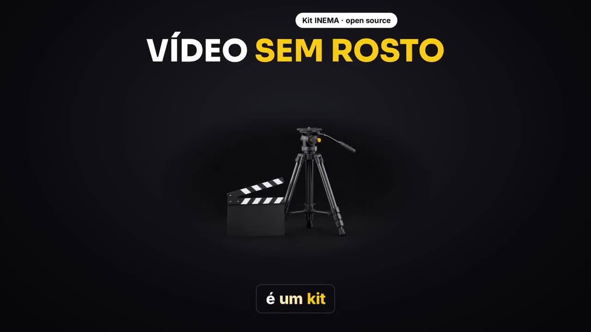

[](https://inematds.github.io/video-sem-rosto/guia/en/)

**🇧🇷 [Português](README.md) · 🇺🇸 [English](README.en.md) · 🇪🇸 [Español](README.es.md)**

## What it is

video-sem-rosto is a kit (a "skill") that teaches Claude Code to make horizontal explainer videos without recording anything: no camera, no avatar. It is for anyone who wants to explain a tool, a repository or a piece of news on video without appearing on screen and without paying for a voice service. The voice is generated on your computer with a cloned voice, and the scenes show the real web page, 3D images and synced captions. To use it, you need Claude Code, ffmpeg, Python and inemavox (which handles the voice and transcription) running on your machine.

## 📖 User guide

Full guide (landing page + step by step): **https://inematds.github.io/video-sem-rosto/guia/en/** · Test video: [release 1.0.1](https://github.com/inematds/video-sem-rosto/releases/tag/v1.0.1)


## 🎬 Examples

| Example 1 — reel look: the kit itself (~40 s) | Example 2 — ledger look: yt-pubx (~35 s) |
|---|---|
| [](https://inematds.github.io/video-sem-rosto/guia/assets/exemplo-reel.mp4) | [](https://inematds.github.io/video-sem-rosto/guia/assets/exemplo-ledger.mp4) |

Click the image to open the video (narration in Portuguese). In 1080p60: [release 1.0.1](https://github.com/inematds/video-sem-rosto/releases/tag/v1.0.1). Both come from `templates/exemplo_30s.py` and `templates/exemplo_ledger.py`.

---

**A 16:9 explainer video with no camera and no avatar, made by Claude Code from a link or a topic.**
The agent researches the official source, writes the script, you approve it, the voice is generated **on your machine** and each sentence becomes a motion-design scene: title, real screenshot of the site, 3D image and word-by-word caption, in 1080p at 60 frames per second.

- 🎙️ **Local voice** (Chatterbox, cloned voice) with the timing of each word measured by local Whisper, **no paid API**.
- 🎨 **INEMA theme**: black `#0c0c10`, light paper, yellow `#FACC15`, Sora headings, Inter body.
- 🖼️ **Real screenshots**: opens the page, finds the text the voice quotes and zooms in on it.
- 🎬 **3 looks** (reel, cinema, ledger) so the videos don't all look the same.
- ✅ **Gates**: script approved before the voice; a badly spoken sentence is regenerated; technical QC at the end.

Included test: a ~40 s video about the kit itself (`templates/exemplo_30s.py`).

---

## The process, from start to finish

Who does it: 🧠 session with Nei · ⚙️ script · 🤖 agent (Claude Code following `SKILL.md` (in Portuguese))

| # | Step | Command / action | Who |
|---|---|---|---|
| 1 | Ask for the video | "make a faceless video about `<link>`, around 8 minutes" | 🧠 |
| 2 | Research the official source and note every fact | reads repo/docs/announcement; whatever doesn't check out stays out | 🤖 |
| 3 | Write the script | `<job>/<Title> - roteiro.md` + `script.txt` (template: `templates/roteiro_longo_modelo.md`) | 🤖 |
| 4 | **Approve the script** (gate) | the agent shows word count, duration and where the callouts fall; nothing is generated before the "ok" | 🧠 |
| 5 | Generate the voice with per-word timing | `python3 scripts/tts.py <job>` → `vo.mp3`, `words.json`, `vo_qc.json` | ⚙️ |
| 6 | 3D images (in parallel with 5) | `python3 scripts/images.py <job>/img c_x="…" d_y="…"` (Codex via subscription) | ⚙️ |
| 7 | Site screenshots (in parallel with 5) | `$FVPY scripts/capture.py <url> <job>/cap/x.png "text"` | ⚙️ |
| 8 | Write the scenes from the word timings | `job.py` copied from `templates/` (long: `job_full_template.py` + one subagent per section) | 🤖 |
| 9 | Check the contact sheet | `$FVPY job.py stills` → `out/stills.jpg`; fix and check again | 🤖 |
| 10 | Render 1080p60 | `$FVPY job.py` → `out/<name>.mp4` | ⚙️ |
| 11 | Technical QC + look at the sheet | `python3 scripts/qc.py out/<name>.mp4` | ⚙️ + 🤖 |
| 12 | Thumbs + description with chapters | Codex image_gen with the hook drawn in; chapters taken from the script | 🤖 |
| 13 | Publish | `yt-pubx publicar … --dry-run` → review → publish; ES goes to `fila_es.py` | 🧠 approves · ⚙️ publishes |

`$FVPY` = `~/projetos/video-sem-rosto/.venv/bin/python` (created by `setup.sh`). Run render and capture with
`TMPDIR=$(mktemp -d /tmp/fv.XXXX)` in front: Chromium aborts when the socket path is too long.

---

## Installation (once, ~5 min)

Prerequisites (`setup.sh` checks them and tells you what's missing):

| What | What for | How to install |
|---|---|---|
| Python 3 + ffmpeg | engine and encoding | `sudo apt install python3-venv ffmpeg` |
| [inemavox](https://github.com/inematds/inemavox) | Chatterbox worker + `venv` with faster-whisper (per-word timing) | `git clone https://github.com/inematds/inemavox ~/projetos/inemavox && cd ~/projetos/inemavox && python3 -m venv venv && venv/bin/pip install faster-whisper soundfile numpy` |
| Chatterbox (conda `chatterbox`) | open model that clones a voice from a short audio clip (GPU recommended) | `conda create -n chatterbox python=3.11 -y && ~/miniconda3/envs/chatterbox/bin/pip install chatterbox-tts soundfile` |
| Reference voice | the narrating voice: 10 s of clean speech, `.wav` 24 kHz mono | `ffmpeg -i gravacao.m4a -ss 2 -t 10 -ac 1 -ar 24000 ~/minha-voz.wav && export FV_VOICE=~/minha-voz.wav` |
| Codex CLI logged in (optional) | 3D images via the ChatGPT subscription | `codex login` — without it, use only screenshots/logos or `FV_IMG=flux` if you have a local flux2-klein server |

Different paths? `INEMAVOX_DIR`, `CHATTERBOX_PYTHON`, `FV_VOICE` (name in `FV_VOICE_DIR` or a `.wav` path). At INEMA, `FV_VOICE=nei` uses the voice already recorded in `~/projetos/timesmkt3/media/voice-refs/`.

```bash
git clone https://github.com/inematds/video-sem-rosto ~/projetos/video-sem-rosto
cd ~/projetos/video-sem-rosto
bash setup.sh          # creates .venv, installs Playwright+Chromium, checks voice/Whisper, links the skill
                       # must end with: SELFTEST PASS
```

Set the voice permanently in your shell (`echo 'export FV_VOICE=~/minha-voz.wav' >> ~/.bashrc`) and edit `PROFILE.md` (in Portuguese): it ships with the INEMA profile (call to action for inema.club, publishing via yt-pubx, bot notifications) — replace the name, call to action, channel and rules with your own. On the first run, Whisper large-v3 (~3 GB) and Chatterbox download their weights. If Playwright asks for system libraries: `sudo .venv/bin/python -m playwright install-deps chromium`.

`setup.sh` creates the link `~/.claude/skills/video-sem-rosto → this repo`. From then on, in Claude Code:

```
faz um vídeo sem rosto sobre https://github.com/dono/projeto — uns 8 minutos, me mostra o roteiro antes
```

### 30–40 s test

```bash
J=~/projetos/output/video-sem-rosto/teste; mkdir -p $J/img $J/cap
cp templates/exemplo_30s.py $J/job.py
cp templates/exemplo_30s.txt $J/script.txt
python3 scripts/tts.py $J                                         # voice + words.json
python3 scripts/images.py $J/img d_clap="a film clapperboard beside an empty tripod" d_monitor="a widescreen monitor with a play button"
TMPDIR=$(mktemp -d /tmp/fv.XXXX) .venv/bin/python scripts/capture.py https://github.com/inematds/yt-pubx $J/cap/gh.png
TMPDIR=$(mktemp -d /tmp/fv.XXXX) .venv/bin/python $J/job.py stills   # look at out/stills.jpg
TMPDIR=$(mktemp -d /tmp/fv.XXXX) .venv/bin/python $J/job.py          # render
python3 scripts/qc.py $J/out/video-sem-rosto-teste.mp4
```

The example expects `img/d_clap.png`, `img/d_monitor.png` and `cap/gh.png` (the commands above generate them with those names). The scene timings are those of the voice generated here; with a different voice, adjust the `v.scene(start, end, …)` calls by reading `words.json`.

---

## How it works inside

### Voice (`scripts/tts.py` + `scripts/_align.py`)
1. `script.txt` is split into **beats** (blank line) and **sentences** (up to 160 characters).
2. The Chatterbox worker (inemavox) generates all the sentences in a single model load, using the voice from `FV_VOICE` (default `nei`, cfg 0.6 / exaggeration 0.6).
3. Local Whisper large-v3 (same lock as explicavideos, one at a time on the GPU) trims the silence at the edges, listens to each sentence and compares it with the text.
4. A sentence with similarity < `FV_MIN_SIM` (0.80) is **regenerated** (up to 2 times). If it is still bad, the script stops and points to the sentence in `vo_qc.json` — rewrite it (spell the number out, spell the acronym out letter by letter).
5. It joins everything with pauses (0.28 s between sentences, 0.55 s between beats). `words.json` carries the **script's spelling** with the timing heard by Whisper; a word with no match is interpolated between its neighbours.

| Variable | Default | What it does |
|---|---|---|
| `FV_VOICE` | `nei` | `nei`, `nei2`, `nei3`, `nei4` or the path to a reference `.wav` (10 s, 24 kHz mono) |
| `FV_LANG` | `pt` | voice and Whisper language (`en`, `es`…) |
| `FV_ATEMPO` | `1.0` | speeds up the voice (max 1.15) |
| `FV_MIN_SIM` | `0.80` | minimum similarity per sentence |
| `FV_CFG` / `FV_EXAG` | `0.6` / `0.6` | Chatterbox tuning |

### Scenes (`scripts/fv.py`)
Each scene is **one HTML page** with CSS animations in absolute seconds of the narration. Headless Chromium (Playwright) steps frame by frame with `document.getAnimations()` and sends the frames to ffmpeg in 4 s chunks in parallel; at the end, it mixes in the voice (−14 LUFS) and the optional soundtrack.

Available pieces:

| Piece | What it draws |
|---|---|
| `kicker(text, t)` | pill at the top with the source ("GitHub · owner/repo") |
| `head(text, t, per_word=[…])` | uppercase title, words coming in on the beat of the speech |
| `title(text, t)` | title in sentence case |
| `hero(img, t)` | 3D render with a feathered edge and gentle floating |
| `chip(text, t, x, y, ico=, accent=)` | label with a Lucide icon; `accent` = yellow |
| `tile(logo_src("github"), t, x, y, label=)` | app icon with the official logo (Simple Icons) |
| `browser(print, t, x, y, w, h, scroll=, zoom=)` | real screenshot in a browser window, with scrolling and zoom |
| `stamp(text, t, x, y)` | red stamp with a big number |
| `ring(t, x, y, w, h)` | ring highlighting a passage |
| `card(html, t, x, y, w)` | white card |
| `cursor_click(t0, t1, x0, y0, x1, y1)` | cursor that moves and clicks |
| `big_card([(text, t), …])` | full-screen yellow card (one strong statement) |
| `clip(mp4, t, x, y, w, start=, credit=)` | muted excerpt of official video, with a short credit |
| `offer_page(t)` / `reviews_wall(t, dur)` | screenshot of the inema.club page / testimonials (optional, in `assets/proof/`) |

In text: `*word*` = highlight (yellow on dark, marker-pen on light), `_word_` = secondary highlight.

### Looks
- **reel** (default): paper ↔ black, chips, 3D render, karaoke caption.
- **cinema**: `Video(job, look="cinema")` + `templates/pieces_cinema.py` — real image first, slow Ken Burns, letterbox, callouts pointing at the product.
- **ledger**: `Video(job, look="ledger")` + `templates/pieces_ledger.py` — release notes, counters, changelog lines.

`FV_THEME=inema` (default) applies the INEMA colours and fonts to all three. `FV_THEME=original` goes back to the cream/orange palette of the base kit.

### Sound
Voice only, at −14 LUFS, plus an optional soundtrack (`<job>/music.mp3`, from inemavox) at −26 dB. **No whoosh** on the cuts (INEMA rule); `FV_WHOOSH=1` turns it on if requested.

### 3D images (`scripts/images.py`)
Codex CLI `image_gen` via the ChatGPT subscription (no API), 3 in parallel, ~1–2 min each. House style added automatically: premium matte render, neutral light (no yellowish cast), one object, plain background (`c_` paper / `d_` black), robot only as an industrial humanoid. Fallback: `FV_IMG=flux` uses the local flux2-klein (`localhost:8000`).

### Screenshots (`scripts/capture.py`)
Opens the page at 1600 px (scale 1.5), removes fixed bars and cookie notices, saves the full page (up to 6000 px) and a `.json` with the box of each requested text — so you can aim `zoom`, `scroll` and `ring` exactly at what the voice is saying. Sites that block headless browsers (Hugging Face, X) need a manual screenshot.

---

## Script rules (summary of `SKILL.md`)
- The 1st sentence names the tool and says what it is.
- One idea per sentence; explain how it works **inside** the tool, with no generic use case.
- Before × now = against the limitation of the original product.
- No hype, no invented numbers, no "the README says", no narrating social media.
- Call to action for **INEMA.CLUB** at ~3:00 and at the end, tied to the video's topic.
- Excerpt of official video: 3–8 s, muted, with a short credit, at most 30 % of the video.

---

## Where this is useful in our projects

What the kit brings that is new compared with what we already have: **local voice with checked per-word timing**, **real screenshot with zoom on the text the voice quotes** (`capture.py` returns the text box), **three rotating looks** and **official-clip policy** (short, muted, ≤ 30 %). Candidates, from the most direct to the most distant:

| Project | How the kit helps | Note |
|---|---|---|
| **explicavideos** (`sem_avatar` profile, 2.23.11) | A no-avatar version without depending on recording in HeyGen: the voice comes from local Chatterbox in minutes | Today the no-avatar version still uses the recorded avatar's voice; here there is no recording at all |
| **Project/guide video on the portal** (`inematds/*` repos) | Each new repo gets a 2–5 min video with real screenshots of GitHub and the guide, at no HeyGen cost | Fits at the end of `projetos-landing-guia` / `atualiza-portal` |
| **refazvideo** | Alternative when there is no OK for an avatar: same script, local `nei` voice, `cinema` look | The base video still carries no written credit |
| **Tool news (INEMA.VIDEOS, lives4)** | "X is out" becomes a 5–8 min video the same day: research → script → render, with a screenshot of the announcement | Good for daily volume without spending avatar credit |
| **EN/ES versions** | `inema-traduz` on `script.txt` + `FV_LANG=en|es` — redoes voice and captions without re-recording anything | ES follows the `fila_es.py` queue |
| **videos-cursos-inema** | Track/module video with a screenshot of the course page and zoom on the step | `ledger`/`reel` looks suit a lesson |
| **docflow / finviral (long version)** | `stamp`, counter and `big_card` pieces for numbers | Only where the topic is a tool or data; documentary stays in docflow |
| **video-explicativo / faceless-explainer** | Same family (HTML → MP4); worth porting `capture.py` + text boxes over there | Not a replacement: those are 1–3 min concept videos with no site to show |

Does not replace: **r7ex / makeshorts / reel-edita** (9:16 with avatar and 7 steps) nor the **explicavideo with avatar** when Nei's face is the point of the video.

---

## Structure

```
SKILL.md                    instructions that Claude Code follows
PROFILE.md                  INEMA voice, call to action, look and banned words
setup.sh / requirements.txt installation + self-test (SELFTEST PASS)
scripts/fv.py               scene engine, INEMA theme, render and mixing
scripts/tts.py, _align.py   local voice + per-word timing + regeneration of a bad sentence
scripts/images.py           3D renders (Codex via subscription; local flux as fallback)
scripts/capture.py          full-page screenshot + text boxes
scripts/qc.py               technical QC + contact sheet
templates/                  30 s example, long script template, long job, cinema/ledger look pieces, app screens
sfx/                        whoosh/pop/tick (off by default)
assets/proof/               optional screenshots for the call to action (inema.club page, testimonials)
```

## Working folders
Each video lives in `~/projetos/output/video-sem-rosto/<date>-<slug>/` with `script.txt`, `vo.mp3`, `words.json`, `img/`, `cap/`, `clips/`, `job.py` and `out/`.

## Version
`1.0.1` — 10/26/2026. History in `CHANGELOG.md`.
