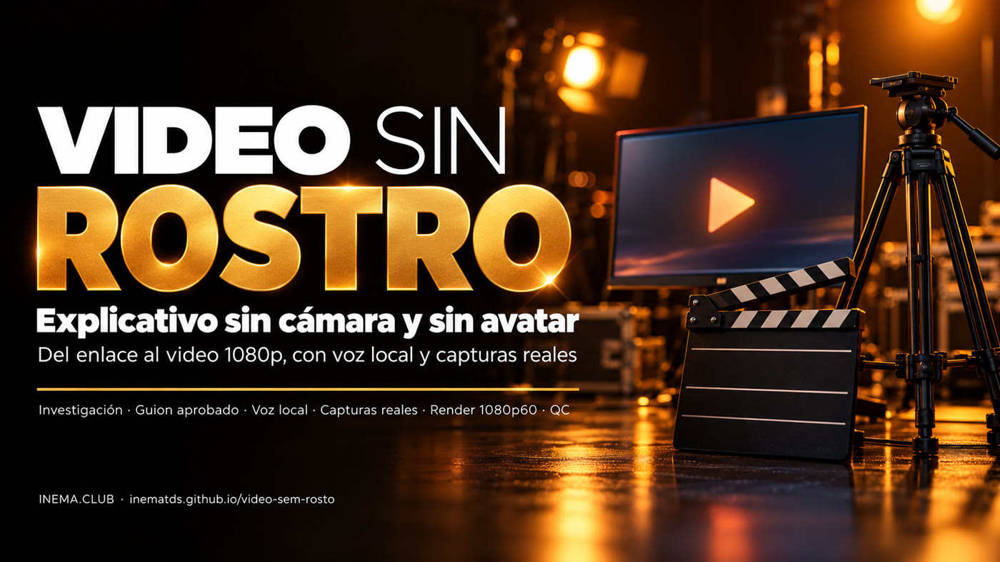

[](https://inematds.github.io/video-sem-rosto/guia/es/)

**🇧🇷 [Português](README.md) · 🇺🇸 [English](README.en.md) · 🇪🇸 [Español](README.es.md)**

## Qué es

video-sem-rosto es un kit (una "skill") que enseña a Claude Code a hacer videos explicativos en horizontal sin grabar nada: sin cámara, sin avatar. Sirve para quien quiere explicar una herramienta, un repositorio o una novedad en video sin aparecer y sin pagar un servicio de voz. La voz se genera en tu computadora con una voz clonada, y las escenas muestran la página real del sitio, imágenes 3D y subtítulos sincronizados. Para usarlo, necesitas Claude Code, ffmpeg, Python e inemavox (que hace la voz y la transcripción) funcionando en la máquina.

## 📖 Guía de uso

Guía completa (landing + paso a paso): **https://inematds.github.io/video-sem-rosto/guia/es/** · Video de prueba: [release 1.0.0](https://github.com/inematds/video-sem-rosto/releases/tag/v1.0.0)

---

**Video explicativo 16:9 sin cámara y sin avatar, hecho por Claude Code a partir de un enlace o tema.**
El agente investiga la fuente oficial, escribe el guion, tú lo apruebas, la voz se genera **en tu máquina** y cada frase se convierte en una escena de motion design — título, captura real del sitio, imagen 3D y subtítulos palabra por palabra — en 1080p a 60 cuadros.

- 🎙️ **Voz local** (Chatterbox, voz clonada) con el tiempo de cada palabra medido por Whisper local — **ninguna API de pago**.
- 🎨 **Tema INEMA**: negro `#0c0c10`, papel claro, amarillo `#FACC15`, títulos Sora, cuerpo Inter.
- 🖼️ **Capturas reales**: abre la página, encuentra el texto que cita la voz y le hace zoom.
- 🎬 **3 looks** (reel, cinema, ledger) para que los videos no se vean todos iguales.
- ✅ **Compuertas**: guion aprobado antes de la voz; la frase mal pronunciada se genera de nuevo; QC técnico al final.

Prueba incluida: un video de ~40 s sobre el propio kit (`templates/exemplo_30s.py`).

---

## El proceso, de principio a fin

Quién lo hace: 🧠 sesión con Nei · ⚙️ script · 🤖 agente (Claude Code siguiendo el `SKILL.md` (en portugués))

| # | Paso | Comando / acción | Quién |
|---|---|---|---|
| 1 | Pedir el video | "haz un video sin rostro sobre `<link>`, unos 8 minutos" | 🧠 |
| 2 | Investigar la fuente oficial y anotar cada hecho | lee repo/docs/anuncio; lo que no coincide queda fuera | 🤖 |
| 3 | Escribir el guion | `<job>/<Título> - roteiro.md` + `script.txt` (modelo: `templates/roteiro_longo_modelo.md`) | 🤖 |
| 4 | **Aprobar el guion** (compuerta) | el agente muestra palabras, duración y dónde caen las llamadas; no se genera nada antes del "ok" | 🧠 |
| 5 | Generar la voz con tiempo por palabra | `python3 scripts/tts.py <job>` → `vo.mp3`, `words.json`, `vo_qc.json` | ⚙️ |
| 6 | Imágenes 3D (en paralelo con el 5) | `python3 scripts/images.py <job>/img c_x="…" d_y="…"` (Codex por la suscripción) | ⚙️ |
| 7 | Capturas de los sitios (en paralelo con el 5) | `$FVPY scripts/capture.py <url> <job>/cap/x.png "texto"` | ⚙️ |
| 8 | Escribir las escenas según los tiempos de las palabras | `job.py` copiado de `templates/` (largo: `job_full_template.py` + subagentes por tramo) | 🤖 |
| 9 | Revisar la hoja de escenas | `$FVPY job.py stills` → `out/stills.jpg`; corrige y revisa de nuevo | 🤖 |
| 10 | Render 1080p60 | `$FVPY job.py` → `out/<nombre>.mp4` | ⚙️ |
| 11 | QC técnico + mirar la hoja | `python3 scripts/qc.py out/<nombre>.mp4` | ⚙️ + 🤖 |
| 12 | Miniaturas + descripción con capítulos | Codex image_gen con el gancho dibujado; capítulos sacados del guion | 🤖 |
| 13 | Publicar | `yt-pubx publicar … --dry-run` → revisar → publicar; ES va a `fila_es.py` | 🧠 aprueba · ⚙️ publica |

`$FVPY` = `~/projetos/video-sem-rosto/.venv/bin/python` (creado por `setup.sh`). Ejecuta render y captura con
`TMPDIR=$(mktemp -d /tmp/fv.XXXX)` por delante: Chromium aborta con una ruta de socket demasiado larga.

---

## Instalación (una vez, ~5 min)

Requisitos previos (`setup.sh` los verifica y dice qué falta):

| Qué | Para qué | Cómo instalar |
|---|---|---|
| Python 3 + ffmpeg | motor y encode | `sudo apt install python3-venv ffmpeg` |
| [inemavox](https://github.com/inematds/inemavox) | worker de Chatterbox + `venv` con faster-whisper (tiempo por palabra) | `git clone https://github.com/inematds/inemavox ~/projetos/inemavox && cd ~/projetos/inemavox && python3 -m venv venv && venv/bin/pip install faster-whisper soundfile numpy` |
| Chatterbox (conda `chatterbox`) | modelo abierto que clona la voz a partir de un audio corto (GPU recomendada) | `conda create -n chatterbox python=3.11 -y && ~/miniconda3/envs/chatterbox/bin/pip install chatterbox-tts soundfile` |
| Voz de referencia | la voz que narra: 10 s de habla limpia, `.wav` 24 kHz mono | `ffmpeg -i gravacao.m4a -ss 2 -t 10 -ac 1 -ar 24000 ~/minha-voz.wav && export FV_VOICE=~/minha-voz.wav` |
| Codex CLI con sesión iniciada (opcional) | imágenes 3D por la suscripción de ChatGPT | `codex login` — sin él, usa solo capturas/logos o `FV_IMG=flux` si tienes un servidor flux2-klein local |

¿Rutas diferentes? `INEMAVOX_DIR`, `CHATTERBOX_PYTHON`, `FV_VOICE` (nombre en `FV_VOICE_DIR` o ruta `.wav`). En INEMA, `FV_VOICE=nei` usa la voz ya grabada en `~/projetos/timesmkt3/media/voice-refs/`.

```bash
git clone https://github.com/inematds/video-sem-rosto ~/projetos/video-sem-rosto
cd ~/projetos/video-sem-rosto
bash setup.sh          # crea .venv, instala Playwright+Chromium, verifica voz/Whisper, activa la skill
                       # tiene que terminar con: SELFTEST PASS
```

Deja la voz fija en el shell (`echo 'export FV_VOICE=~/minha-voz.wav' >> ~/.bashrc`) y edita el `PROFILE.md` (en portugués): viene con el perfil de INEMA (llamada a inema.club, publicación con yt-pubx, avisos en el bot) — cambia nombre, llamada, canal y reglas por los tuyos. En la 1.ª ejecución Whisper large-v3 (~3 GB) y Chatterbox descargan los pesos. Si Playwright pide bibliotecas del sistema: `sudo .venv/bin/python -m playwright install-deps chromium`.

`setup.sh` crea el enlace `~/.claude/skills/video-sem-rosto → este repo`. A partir de ahí, en Claude Code:

```
haz un video sin rostro sobre https://github.com/dono/projeto — unos 8 minutos, muéstrame el guion antes
```

### Prueba de 30–40 s

```bash
J=~/projetos/output/video-sem-rosto/teste; mkdir -p $J/img $J/cap
cp templates/exemplo_30s.py $J/job.py
cp templates/exemplo_30s.txt $J/script.txt
python3 scripts/tts.py $J                                         # voz + words.json
python3 scripts/images.py $J/img d_clap="a film clapperboard beside an empty tripod" d_monitor="a widescreen monitor with a play button"
TMPDIR=$(mktemp -d /tmp/fv.XXXX) .venv/bin/python scripts/capture.py https://github.com/inematds/yt-pubx $J/cap/gh.png
TMPDIR=$(mktemp -d /tmp/fv.XXXX) .venv/bin/python $J/job.py stills   # mira out/stills.jpg
TMPDIR=$(mktemp -d /tmp/fv.XXXX) .venv/bin/python $J/job.py          # render
python3 scripts/qc.py $J/out/video-sem-rosto-teste.mp4
```

El ejemplo espera `img/d_clap.png`, `img/d_monitor.png` y `cap/gh.png` (los comandos anteriores los generan con esos nombres). Los tiempos de las escenas son los de la voz generada aquí; con otra voz, ajusta los `v.scene(inicio, fin, …)` leyendo el `words.json`.

---

## Cómo funciona por dentro

### Voz (`scripts/tts.py` + `scripts/_align.py`)
1. El `script.txt` se divide en **bloques** (línea en blanco) y **frases** (hasta 160 caracteres).
2. El worker de Chatterbox (inemavox) genera todas las frases en una sola carga del modelo, con la voz de `FV_VOICE` (por defecto `nei`, cfg 0,6 / exageración 0,6).
3. Whisper large-v3 local (mismo lock de explicavideos, uno a la vez en la GPU) recorta el silencio de los extremos, escucha cada frase y la compara con el texto.
4. Una frase con similitud < `FV_MIN_SIM` (0,80) se **genera de nuevo** (hasta 2 veces). Si sigue mal, el script se detiene y señala la frase en `vo_qc.json` — reescríbela (número en letras, sigla deletreada).
5. Une todo con pausas (0,28 s entre frases, 0,55 s entre bloques). El `words.json` lleva la **ortografía del guion** con el tiempo escuchado por Whisper; una palabra sin par se interpola entre las vecinas.

| Variable | Por defecto | Qué hace |
|---|---|---|
| `FV_VOICE` | `nei` | `nei`, `nei2`, `nei3`, `nei4` o ruta de un `.wav` de referencia (10 s, 24 kHz mono) |
| `FV_LANG` | `pt` | idioma de la voz y de Whisper (`en`, `es`…) |
| `FV_ATEMPO` | `1.0` | acelera la voz (máx. 1,15) |
| `FV_MIN_SIM` | `0.80` | similitud mínima por frase |
| `FV_CFG` / `FV_EXAG` | `0.6` / `0.6` | ajuste de Chatterbox |

### Escenas (`scripts/fv.py`)
Cada escena es **una página HTML** con animaciones CSS en segundos absolutos de la narración. Chromium headless (Playwright) avanza cuadro a cuadro con `document.getAnimations()` y envía los cuadros a ffmpeg en trozos de 4 s en paralelo; al final, mezcla la voz (−14 LUFS) y la pista opcional.

Piezas disponibles:

| Pieza | Qué dibuja |
|---|---|
| `kicker(texto, t)` | píldora arriba con el origen ("GitHub · dono/repo") |
| `head(texto, t, per_word=[…])` | título en mayúsculas, palabras entrando al ritmo del habla |
| `title(texto, t)` | título en frase normal |
| `hero(img, t)` | render 3D con borde difuminado y flotación suave |
| `chip(texto, t, x, y, ico=, accent=)` | etiqueta con ícono Lucide; `accent` = amarilla |
| `tile(logo_src("github"), t, x, y, label=)` | ícono de app con logo oficial (Simple Icons) |
| `browser(print, t, x, y, w, h, scroll=, zoom=)` | captura real en una ventana de navegador, con scroll y zoom |
| `stamp(texto, t, x, y)` | sello rojo de número grande |
| `ring(t, x, y, w, h)` | anillo que destaca un fragmento |
| `card(html, t, x, y, w)` | tarjeta blanca |
| `cursor_click(t0, t1, x0, y0, x1, y1)` | cursor que se mueve y hace clic |
| `big_card([(texto, t), …])` | tarjeta amarilla a pantalla completa (una afirmación fuerte) |
| `clip(mp4, t, x, y, w, start=, credit=)` | fragmento mudo de video oficial, con crédito corto |
| `offer_page(t)` / `reviews_wall(t, dur)` | captura de la página de inema.club / testimonios (opcional, en `assets/proof/`) |

En el texto: `*palabra*` = resaltado (amarillo en oscuro, marcatextos en claro), `_palabra_` = resaltado secundario.

### Looks
- **reel** (por defecto): papel ↔ negro, chips, render 3D, subtítulos karaoke.
- **cinema**: `Video(job, look="cinema")` + `templates/pieces_cinema.py` — imagen real primero, Ken Burns lento, letterbox, llamadas que apuntan al producto.
- **ledger**: `Video(job, look="ledger")` + `templates/pieces_ledger.py` — notas de versión, contadores, líneas de changelog.

`FV_THEME=inema` (por defecto) aplica los colores y fuentes INEMA en los tres. `FV_THEME=original` vuelve a la paleta crema/naranja del kit base.

### Sonido
Solo voz, a −14 LUFS, y pista opcional (`<job>/music.mp3`, de inemavox) a −26 dB. **Sin whoosh** en los cortes (regla INEMA); `FV_WHOOSH=1` lo activa si se pide.

### Imágenes 3D (`scripts/images.py`)
Codex CLI `image_gen` por la suscripción de ChatGPT (sin API), 3 en paralelo, ~1–2 min cada una. Estilo de la casa añadido automáticamente: render mate premium, luz neutra (sin tono amarillento), un objeto, fondo liso (`c_` papel / `d_` negro), robot solo humanoide industrial. Respaldo: `FV_IMG=flux` usa el flux2-klein local (`localhost:8000`).

### Capturas (`scripts/capture.py`)
Abre la página a 1600 px (escala 1,5), quita barras fijas y avisos de cookies, guarda la página completa (hasta 6000 px) y un `.json` con la caja de cada texto pedido — para apuntar `zoom`, `scroll` y `ring` exactamente a lo que dice la voz. Los sitios que bloquean headless (Hugging Face, X) necesitan captura manual.

---

## Reglas del guion (resumen del `SKILL.md`)
- La 1.ª frase nombra la herramienta y dice qué es.
- Una idea por frase; explicar cómo funciona **dentro** de la herramienta, sin casos de uso genéricos.
- Antes × ahora = contra la limitación del producto original.
- Sin hype, sin números inventados, sin "el README dice", sin narrar redes sociales.
- Llamada a **INEMA.CLUB** a ~3:00 y al final, ligada al tema del video.
- Fragmento de video oficial: 3–8 s, mudo, con crédito corto, como máximo el 30 % del video.

---

## Dónde es útil en nuestros proyectos

Lo que el kit aporta de nuevo respecto a lo que ya tenemos: **voz local con tiempo por palabra verificado**, **captura real con zoom en el texto que cita la voz** (`capture.py` devuelve la caja del texto), **tres looks rotativos** y **política de clip oficial** (corto, mudo, ≤ 30 %). Candidatos, del más directo al más lejano:

| Proyecto | Cómo ayuda el kit | Observación |
|---|---|---|
| **explicavideos** (perfil `sem_avatar`, 2.23.11) | Versión sin avatar sin depender de grabar en HeyGen: la voz sale de Chatterbox local en minutos | Hoy la versión sin avatar todavía usa la voz del avatar grabado; aquí no hay ninguna grabación |
| **Video de proyecto/guía en el portal** (repos `inematds/*`) | Cada repo nuevo gana un video de 2–5 min con capturas reales de GitHub y de la guía, sin costo de HeyGen | Encaja al final de `projetos-landing-guia` / `atualiza-portal` |
| **refazvideo** | Alternativa cuando no hay OK para avatar: mismo guion, voz `nei` local, look `cinema` | El video base sigue sin crédito escrito |
| **Noticia de herramienta (INEMA.VIDEOS, lives4)** | "Salió X" se convierte en un video de 5–8 min el mismo día: investigación → guion → render, con captura del anuncio | Bueno para el volumen diario sin gastar crédito de avatar |
| **Versiones EN/ES** | `inema-traduz` en el `script.txt` + `FV_LANG=en|es` — rehace voz y subtítulos sin regrabar nada | ES sigue la cola `fila_es.py` |
| **videos-cursos-inema** | Video de ruta/módulo con captura de la página del curso y zoom en el paso | Los looks `ledger`/`reel` combinan con la clase |
| **docflow / finviral (versión larga)** | Piezas `stamp`, contador y `big_card` para números | Solo donde el tema es herramienta o dato; el documental sigue en docflow |
| **video-explicativo / faceless-explainer** | Misma familia (HTML → MP4); vale portar `capture.py` + cajas de texto allá | No sustituye: esos son 1–3 min de concepto sin sitio para mostrar |

No sustituye: **r7ex / makeshorts / reel-edita** (9:16 con avatar y 7 etapas) ni el **explicavideo con avatar** cuando el rostro de Nei es la propuesta del video.

---

## Estructura

```
SKILL.md                    instrucciones que sigue Claude Code
PROFILE.md                  voz, llamada, visual y palabras prohibidas de INEMA
setup.sh / requirements.txt instalación + autotest (SELFTEST PASS)
scripts/fv.py               motor de escenas, tema INEMA, render y mezcla
scripts/tts.py, _align.py   voz local + tiempo por palabra + nueva generación de la frase mala
scripts/images.py           renders 3D (Codex por la suscripción; flux local de respaldo)
scripts/capture.py          captura de página completa + cajas de texto
scripts/qc.py               QC técnico + hoja de contacto
templates/                  ejemplo de 30 s, modelo de guion largo, job largo, piezas de los looks cinema/ledger, pantallas de app
sfx/                        whoosh/pop/tick (desactivados por defecto)
assets/proof/               capturas opcionales para la llamada (página de inema.club, testimonios)
```

## Carpetas de trabajo
Cada video queda en `~/projetos/output/video-sem-rosto/<fecha>-<slug>/` con `script.txt`, `vo.mp3`, `words.json`, `img/`, `cap/`, `clips/`, `job.py` y `out/`.

## Versión
`1.0.0` — 25/10/2026. Historial en `CHANGELOG.md`.
